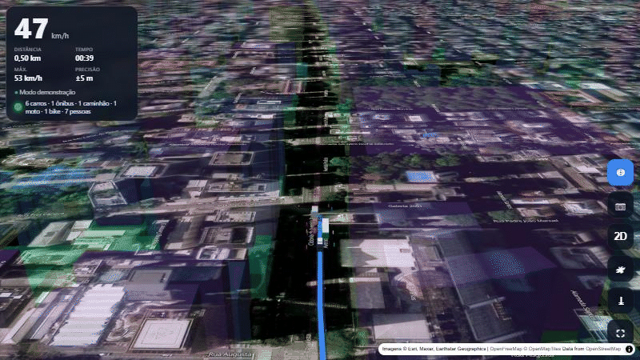
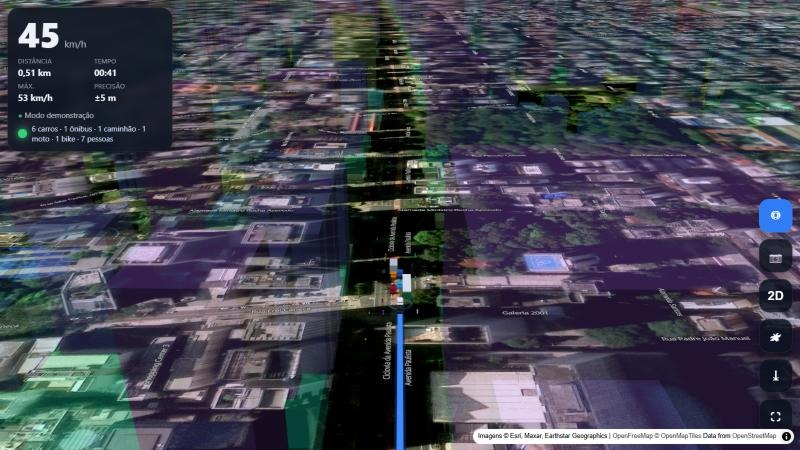
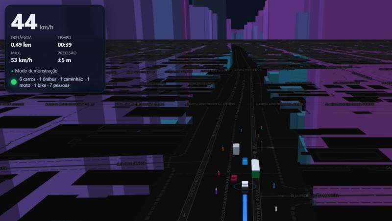

# 🚗 Mapa 3D no Carro

App web que reconstrói em **3D e em tempo real** o trânsito ao redor do carro, no estilo das telas de carros autônomos. A câmera do celular, com IA, detecta carros, ônibus, caminhões, motos, bicicletas, pessoas e semáforos. O app estima a distância de cada um e desenha tudo em 3D em volta do seu carro, sobre o mapa 3D da cidade guiado pelo GPS.

Funciona no navegador do celular (Android e iPhone). Não precisa instalar nada nem criar chave de API.

### ▶️ [Abrir o app](https://sergiorsantana.github.io/mapa3d-carro/)



*Rodando em tempo real no modo demonstração, na Av. Paulista (SP): o trânsito em 3D (carros, ônibus, caminhão, moto, pedestres e semáforo) sobre a imagem de satélite, com os prédios coloridos por altura.*

| Satélite | Noturno |
|---|---|
|  |  |

## Funcionalidades

### IA na câmera
- **Detecção de objetos no próprio celular** (MediaPipe / EfficientDet): carros, caminhões, ônibus, motos, bicicletas, pessoas e semáforos. Nenhuma imagem sai do aparelho.
- **Estimativa de distância e posição** de cada objeto pela geometria da câmera (tamanho conhecido do objeto + posição em relação ao horizonte)
- **Rastreamento** entre quadros, para os objetos não piscarem
- **Cena 3D (Three.js)**: modelos 3D de cada objeto em volta do seu carro. O carro da frente na mesma faixa fica destacado em azul.
- **Cor real dos veículos**: a IA lê a cor da lataria na câmera e pinta o modelo 3D com ela
- **Cor do semáforo** (vermelho, amarelo ou verde) lida da imagem e mostrada no painel
- **Miniatura da câmera** com as caixas de detecção e a distância em metros
- **Dois modelos de IA**: *Rápido* (EfficientDet-Lite0) ou *Preciso* (EfficientDet-Lite2, erra menos com motos, bikes e objetos distantes)
- **Calibração da câmera**: o horizonte é corrigido sozinho pela inclinação do celular (acelerômetro), com ajuste fino, altura e campo de visão no painel ⚙
- **Economia de bateria**: a IA desacelera com o carro parado, com bateria baixa ou quando o celular fica lento/quente

### Direção
- **Aviso de distância do carro da frente**: mostra metros e segundos até ele e bipa quando fica perigoso
- **Navegação**: busque um destino (🧭), a rota é desenhada no mapa com instruções curva a curva, voz em português e recálculo automático se você sair do caminho
- **Limite de velocidade da via** (placa ao lado da velocidade) com alerta ao passar do limite. Quando o OpenStreetMap não tem o dado, mostra um limite **estimado** em cinza pelo tipo de via (CTB), sem alerta
- **Faixas da rua** desenhadas no chão, acompanhando as curvas (número de faixas estimado pelo tipo de via)
- **Dashcam** (⏺): grava um vídeo da viagem com o mapa 3D, a câmera com a IA, a velocidade, a data e a hora
- **Histórico de viagens** (📊): cada viagem é salva sozinha no aparelho, com km, tempo, velocidade média e máxima; dá para ver no mapa, exportar em GPX ou apagar

### Mapa

- **Imagem de satélite real** (API Esri World Imagery, gratuita e sem chave) com os nomes de ruas e lugares por cima
- **Prédios em 3D coloridos** com altura real (dados do OpenStreetMap): amarelo/verde nos baixos, azul/roxo/rosa nos altos
- **Acompanha o carro em tempo real** pelo GPS, com movimento suave
- **O mapa gira** conforme a direção do carro, com câmera inclinada olhando para a frente
- **Zoom automático** pela velocidade (mais perto devagar, mais longe na estrada)
- **Painel** com velocidade, distância, tempo, velocidade máxima e precisão do GPS
- **Trajeto gravado** desenhado no mapa e **exportável em GPX** (abre no Google Earth, Strava etc.)
- **3 visuais**: satélite (padrão de dia), mapa claro e mapa noturno (automático entre 18h e 6h)
- **Tela sempre ligada** durante o uso
- **Modo demonstração** para testar no computador sem GPS
- **Instalável (PWA)**: “Adicionar à tela inicial” e abre em tela cheia; guarda os pedaços de mapa já vistos para quando o sinal cair

## Como instalar no carro

1. Prenda o celular no para-brisa, **deitado (horizontal)**, com a câmera traseira olhando para a rua e o aparelho bem nivelado.
2. Abra o app e toque em **Iniciar: GPS + Câmera com IA**. Permita a câmera e a localização.
3. **Calibre** em ⚙ → *Calibração da câmera*: com a câmera aberta (📷), deixe a linha azul tracejada na altura do fim da rua, lá longe, e informe a altura do celular em relação ao chão. Os ajustes ficam salvos no aparelho.

> ⚠️ Os avisos (distância, limite de velocidade) são **só um auxílio**. A distância vem de uma única câmera e é aproximada. Continue sempre atento ao trânsito.

### Limitações (sendo honesto)
O Tesla Reality View usa 8 câmeras e uma rede neural de cerca de 1 bilhão de parâmetros. Este app usa **uma câmera** e um modelo leve que roda no navegador. Por isso:
- só enxerga o que está **à frente** do carro;
- as distâncias são **aproximadas**: ficam boas até uns 40 m e pioram mais longe ou em subidas e descidas;
- objetos atrás de outros, ou cortados na imagem, podem não aparecer.

## Como publicar no GitHub Pages

1. Crie um repositório no GitHub (ex.: `mapa3d-carro`).
2. Envie os arquivos desta pasta:
   ```powershell
   git init
   git add .
   git commit -m "Mapa 3D no Carro"
   git branch -M main
   git remote add origin https://github.com/SEU-USUARIO/mapa3d-carro.git
   git push -u origin main
   ```
3. No GitHub: **Settings → Pages → Branch: `main` / `(root)` → Save**.
4. Em 1–2 minutos o app estará em `https://SEU-USUARIO.github.io/mapa3d-carro/`.
5. Abra esse link no celular, permita a localização e toque em **Iniciar com GPS**.

> O GPS do navegador só funciona em **HTTPS** — o GitHub Pages já fornece isso.

## Rodar no computador

```powershell
python -m http.server 8765
```

Abra `http://localhost:8765` e toque em **Modo demonstração**. Um carro virtual percorre a Av. Paulista, em São Paulo, com trânsito simulado (carros, ônibus, motos, pedestres e semáforo), sem precisar de câmera.

## Botões

| Botão | Função |
|---|---|
| ◎ | Volta a seguir o carro (depois de arrastar o mapa) |
| 🧭 | Navegar até um destino |
| 📷 | Mostra/esconde a câmera com as detecções da IA |
| ⏺ | Grava a viagem em vídeo (dashcam) |
| 2D / 3D | Alterna entre visão inclinada e vista de cima |
| 🛰 / ☀ / ☾ | Troca o visual: satélite → mapa claro → noturno |
| 📊 | Histórico de viagens |
| ⚙ | Ajustes, calibração e avisos |
| ⤓ | Baixa o trajeto atual em GPX |
| ⛶ | Tela cheia |

## Privacidade

- As imagens da câmera **não saem do celular**: a IA roda no próprio aparelho.
- Histórico de viagens, ajustes e vídeos da dashcam ficam **só no aparelho**.
- A busca de destino envia o texto buscado e a sua posição ao Nominatim e ao OSRM; o limite de velocidade consulta o Overpass com a posição. São serviços públicos do ecossistema OpenStreetMap.

## Tecnologias

- [MapLibre GL JS](https://maplibre.org/) — renderização 3D do mapa (WebGL)
- [Three.js](https://threejs.org/) — modelos 3D dos veículos e pessoas
- [MediaPipe Object Detector](https://ai.google.dev/edge/mediapipe/solutions/vision/object_detector) — IA de detecção no navegador
- [OSRM](https://project-osrm.org/) — cálculo de rotas
- [Nominatim](https://nominatim.org/) — busca de endereços (OpenStreetMap)
- [Overpass API](https://overpass-api.de/) — limite de velocidade das vias (OpenStreetMap)
- [OpenFreeMap](https://openfreemap.org/) — mapas gratuitos, sem chave
- [Esri World Imagery](https://www.arcgis.com/home/item.html?id=10df2279f9684e4a9f6a7f08febac2a9) — imagens de satélite (Esri, Maxar, Earthstar Geographics)
- Dados © [colaboradores do OpenStreetMap](https://www.openstreetmap.org/copyright)

Tudo é HTML, CSS e JavaScript puro, sem etapa de build.

## ⚠️ Segurança

Não mexa no celular enquanto dirige. Prenda o aparelho num suporte e configure tudo antes de sair.

## Licença

MIT
